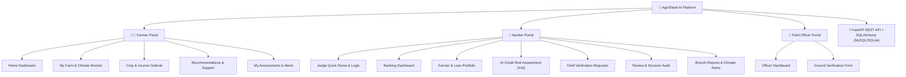

# 🛡️ AgriShield AI — Project Documentation & Presentation Guide

> **Tagline:** Protecting Harvests. Strengthening Financial Futures.  
> **Track:** Climate Intelligence & Agri-Fintech (FIN-03)

---

## 📌 1. Executive Summary

**AgriShield AI** is an end-to-end, climate-aware agricultural credit risk assessment platform designed to bridge the gap between financial institutions and farmers facing climate volatility.

Traditional bank credit scoring relies purely on historical financial records, penalizing farmers during climate anomalies (such as droughts or heatwaves). **AgriShield AI** integrates real-time weather analytics, satellite crop health indicators (NDVI), and machine learning yield predictions to assess true repayment capacity, reduce non-performing assets (NPAs) for commercial banks, and enable fair credit access for smallholder farmers.

---

## 🏛️ 2. System Architecture & Multi-Portal Design

AgriShield AI separates functionality into **three distinct role-based portals** backed by a unified **FastAPI + SQLAlchemy** backend engine:

---

## 🌟 3. Key Portal Features

### 👨‍🌾 A. Farmer Portal
1. **Home Dashboard:** Real-time summary of farm plot size, crop status, active drought/heatwave warnings, and estimated harvest revenue.
2. **My Farm & Climate Monitor:** Interactive Plotly weather trend charts (rainfall, temperature, soil moisture deficit) and satellite NDVI crop health status.
3. **Crop & Income Outlook:** Financial breakdown of farming expenses (seeds, fertilizers, labor, irrigation) vs. gross revenue and scenario stress test (Baseline vs. Drought vs. Heatwave profit).
4. **Recommendations & Relief Support:** Actionable irrigation schedules, Pradhan Mantri Fasal Bima Yojana (PMFBY) insurance application guides, and Kisan Call Centre helpline integration.
5. **My Assessments & Alerts:** Historical risk assessment reports and downloadable PDF scorecards.

---

### 🏦 B. Banker Portal
1. **Judge Quick Demo & Login:** One-click authentication mode (`JUDGE-2026`) for hackathon presentation and role-scoped permissions.
2. **Banking Dashboard:** High-level metrics tracking assigned borrowers, high-risk climate cases, pending field audits, and quick officer action triggers.
3. **Farmer & Loan Portfolio:** Searchable database of borrower loan accounts (KCC loans, outstanding balances, installment repayment schedules).
4. **AI Credit Risk Assessment (XAI):** 
   - Interactive risk gauge score (0–100).
   - Expected crop yield and Debt Service Coverage Ratio (DSCR).
   - **Explainable AI (XAI):** Feature importance breakdown showing the exact factors (e.g. soil moisture, rainfall anomaly) driving the prediction.
5. **Field Verification Requests:** Dispatch ground inspection tasks to field officers with custom verification requirements (damage check, soil audit, geo-tagged photos).
6. **Review & Decision Tracking:** Triangulated review panel combining AI risk score, borrower CIBIL history, and field officer reports to log authorized credit decisions with an immutable audit trail.
7. **Branch Reports & Alerts:** Branch-level risk portfolio exposure (Low, Moderate, High risk tiers in ₹ Crores) and regulatory compliance export actions.

---

### 🚜 C. Field Officer Portal
1. **Officer Dashboard:** Assigned inspection tasks, verified plot tracking, and priority alerts.
2. **Verification Form:** On-ground crop damage evaluation, photo upload, and field remarks submission directly to the Banker Portal.

---

## 🤖 4. Machine Learning & Risk Engine

AgriShield AI uses a **RandomForestRegressor** model trained on climate and agronomy parameters:

### **Model Inputs (Feature Vector):**
* 🌧️ `Rainfall_mm`: Seasonal rainfall (mm)
* 🌡️ `Temperature_C`: Average temperature (°C)
* 💧 `Soil_Moisture`: Soil moisture percentage (%)
* 📐 `Farm_Size_acres`: Total land acreage
* 💰 `Financial_History_Score`: CIBIL/Repayment score (300-850)
* 🌿 `Crop_Health_Index`: Satellite NDVI proxy (0.00 - 1.00)

### **Output Calculations:**
1. **Predicted Yield ($\text{Tons}$)**: Predicted harvest output based on non-linear weather interaction.
2. **Debt Service Coverage Ratio (DSCR)**:
   $$\text{DSCR} = \frac{\text{Estimated Revenue} - \text{Operating Expenses}}{\text{Loan Debt Obligation}}$$
3. **Credit Risk Score ($0 - 100$)**:
   $$\text{Base Risk} = 100 - \left( \frac{\text{CIBIL} - 300}{550} \times 100 \right)$$
   $$\text{Risk Score} = \text{Clip}\left(\text{Base Risk} + \left(2.0 - \frac{\text{Yield}}{\text{Acres}}\right) \times 20, \; 0, \; 100\right)$$

---

## 🛠️ 5. Technology Stack

| Layer | Technology Used |
| :--- | :--- |
| **Frontend UI** | Streamlit (Python), Custom CSS (AgriShield Dark Forest Theme), Plotly Express & Graph Objects |
| **Backend Framework** | FastAPI (Python 3.13), Uvicorn ASGI Server |
| **Database & ORM** | SQLAlchemy, SQLite (`agrishield.db`), PyMySQL (for MySQL integration) |
| **Machine Learning** | Scikit-Learn (`RandomForestRegressor`), Pandas, NumPy |
| **Architecture** | Streamlit Multipage Navigation (`st.navigation`), RESTful API Services |

---

## 🌐 6. REST API Endpoints Reference

Base Server URL: `http://127.0.0.1:8000`

| Method | Endpoint | Description |
| :--- | :--- | :--- |
| `GET` | `/` | API Health Check |
| `GET` | `/docs` | **Swagger Interactive API Documentation** |
| `GET` | `/api/farmers` | Fetch all 500 farmer records from database |
| `GET` | `/api/farmers/{farmer_id}` | Fetch specific farmer profile details & climate baseline |

---

## 🏆 7. Hackathon Presentation Walkthrough (3-Minute Pitch Script)

### **Minute 1: The Problem & Solution**
> *"Judges, current bank credit scoring treats agricultural loans like salaried personal loans. When an unseasonal heatwave hits, a farmer's yield drops, leading to default. Our solution, **AgriShield AI**, integrates climate intelligence directly into bank credit underwriting to predict repayment capacity accurately and provide proactive risk management."*

### **Minute 2: Live Demo — Banker Portal & AI Assessment**
> *"Let us log into the **Banker Portal**. Under **AI Risk Assessment**, we select borrower `FARM-1001 (Ramesh Patil)`. Notice how all details—his loan amount, repayment history, soil type, and rainfall metrics—are loaded dynamically from our **FastAPI + MySQL database**. When we click 'Evaluate AI Risk', our RandomForest model predicts expected yield and calculates a Debt Service Coverage Ratio, while our Explainable AI chart shows the bank officer exact risk drivers."*

### **Minute 3: Multi-Portal & FastAPI Architecture**
> *"AgriShield AI also empowers farmers through the **Farmer Portal** with irrigation recommendations and PMFBY insurance guides, while **Field Officers** verify crop damage on the ground. All data is served live via our **FastAPI backend** accessible at `/docs`. Thank you!"*

---

### 🔑 Demo Credentials for Presentation:
* **Role:** Chief Risk Examiner (Judge Mode)
* **Employee ID:** `JUDGE-2026`
* **Email:** `judge@agrishield.ai`
* **Swagger Docs URL:** `http://127.0.0.1:8000/docs`
